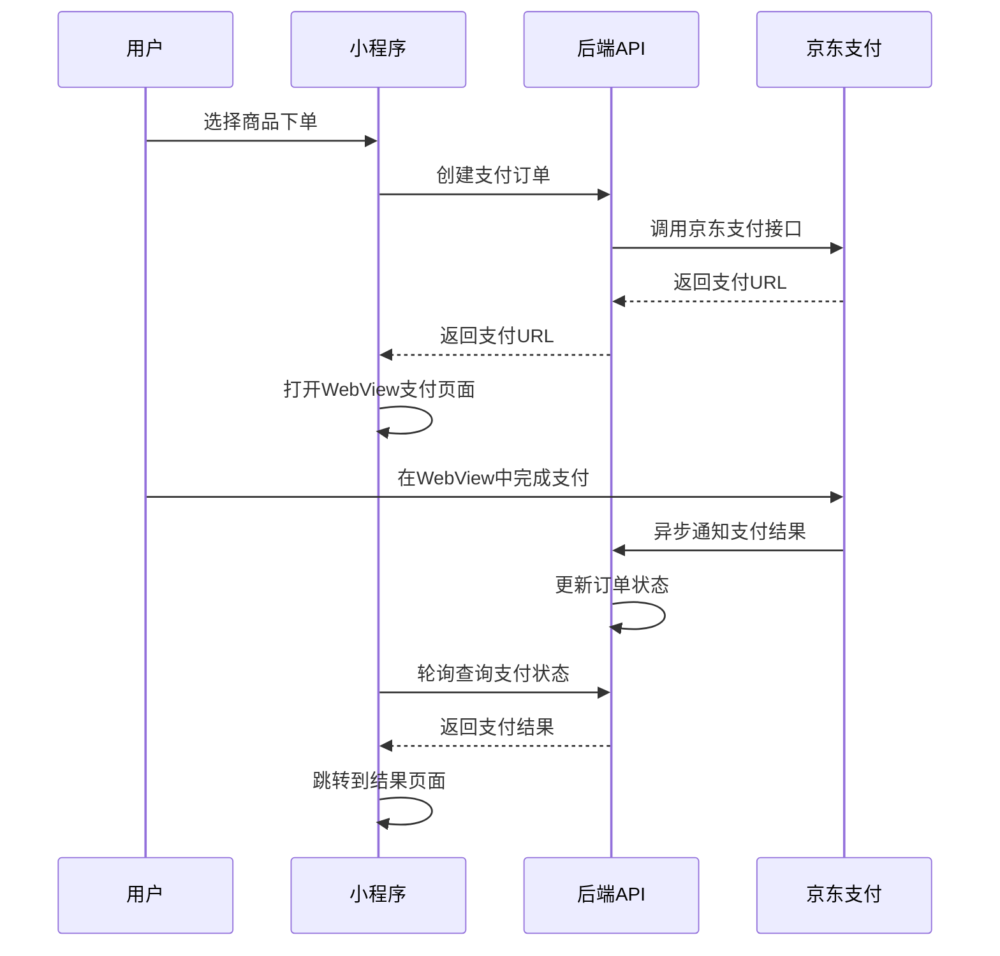

# text_to_voice
# 文字转语音
# 使用的是百度的TTS开放平台，原DEMO中没有这些设置项，我把这些项都加进来了，需要自己去百度申请这个API的接口密钥

# 微信小程序京东支付方案

这是一个完整的微信小程序支持京东协议支付的解决方案。由于微信小程序无法直接调起京东APP，本方案采用WebView方式实现京东支付功能。

## 项目特点

- ✅ 完整的京东支付流程
- ✅ WebView无缝支付体验 
- ✅ 支付状态实时查询
- ✅ 安全的签名验证机制
- ✅ 完善的错误处理
- ✅ 美观的UI界面设计
- ✅ 支持支付结果回调

## 项目结构

```
├── miniprogram/                 # 微信小程序前端
│   ├── app.js                  # 小程序主入口
│   ├── app.json                # 小程序配置
│   ├── pages/
│   │   ├── index/              # 首页（商品展示）
│   │   ├── payment/            # 支付页面
│   │   ├── payment-webview/    # WebView支付页面
│   │   └── payment-result/     # 支付结果页面
│   └── images/                 # 图片资源
├── backend/                    # 后端API
│   ├── jd_payment.php          # 京东支付接口
│   ├── jd_notify.php           # 支付回调处理
│   └── logs/                   # 日志目录
└── README.md                   # 说明文档
```

## 技术方案

### 1. 支付流程设计



### 2. 核心技术要点

- **WebView集成**: 使用小程序web-view组件承载京东支付页面
- **状态轮询**: 通过定时器轮询查询支付状态
- **签名验证**: RSA签名确保数据安全性
- **回调处理**: 异步处理京东支付回调通知

## 快速开始

### 1. 环境要求

- 微信开发者工具
- PHP 7.0+ 
- OpenSSL扩展
- cURL扩展

### 2. 配置说明

#### 后端配置

编辑 `backend/jd_payment.php` 文件，配置您的京东支付参数：

```php
private $config = [
    'merchant_id' => 'YOUR_JD_MERCHANT_ID',  // 京东商户号
    'app_id' => 'YOUR_JD_APP_ID',            // 京东应用ID
    'private_key' => 'YOUR_PRIVATE_KEY',      // 您的私钥
    'public_key' => 'JD_PUBLIC_KEY',          // 京东公钥
    'gateway_url' => 'https://paygate.jd.com/service/unified.trade.query',
    'notify_url' => 'https://your-domain.com/backend/jd_notify.php',
    'return_url' => 'https://your-domain.com/backend/jd_return.php'
];
```

#### 小程序配置

编辑 `miniprogram/app.js` 文件，配置后端服务器地址：

```javascript
globalData: {
    userInfo: null,
    serverUrl: 'https://your-domain.com/api'  // 修改为您的后端地址
}
```

### 3. 部署步骤

1. **部署后端**
   ```bash
   # 上传backend目录到服务器
   # 确保PHP环境支持OpenSSL和cURL
   # 设置logs和orders目录写权限
   chmod 755 backend/logs
   chmod 755 backend/orders
   ```

2. **配置小程序**
   ```bash
   # 导入miniprogram目录到微信开发者工具
   # 配置服务器域名白名单
   # 添加 your-domain.com 到request合法域名
   # 添加 h5pay.jd.com 到web-view合法域名
   ```

3. **测试支付**
   - 在微信开发者工具中运行小程序
   - 选择商品点击购买
   - 选择京东支付方式
   - 在WebView中完成支付测试

## API接口说明

### 创建支付订单

```http
POST /backend/jd_payment.php/create_order
Content-Type: application/json

{
    "out_trade_no": "订单号",
    "subject": "商品名称", 
    "body": "商品描述",
    "total_amount": 100.00,
    "user_id": "用户ID"
}
```

**响应**:
```json
{
    "code": 0,
    "message": "success",
    "data": {
        "pay_url": "https://h5pay.jd.com/jdpay/saveOrder?...",
        "trade_no": "订单号",
        "timestamp": 1635724800
    }
}
```

### 查询支付状态

```http
GET /backend/jd_payment.php/query_status?trade_no=订单号
```

**响应**:
```json
{
    "code": 0,
    "message": "success", 
    "data": {
        "trade_status": "success",
        "trade_no": "订单号",
        "amount": 100.00
    }
}
```

## 支付回调处理

京东支付完成后会异步通知到配置的回调地址：

```php
// backend/jd_notify.php 处理逻辑
- 验证签名确保数据来源可靠
- 更新订单状态到数据库
- 记录操作日志
- 返回处理结果给京东
```

## 注意事项

### 1. 安全性

- **签名验证**: 务必验证京东回调数据的签名
- **HTTPS**: 生产环境必须使用HTTPS协议
- **密钥保护**: 私钥文件不要暴露在web目录下

### 2. 兼容性

- **小程序版本**: 支持基础库2.0+
- **WebView限制**: 需要在小程序后台配置web-view域名白名单
- **iOS限制**: iOS系统可能对WebView支付有限制

### 3. 用户体验

- **加载状态**: WebView加载时显示加载动画
- **错误处理**: 提供重试和客服联系方式
- **状态同步**: 支付完成后及时更新页面状态

## 常见问题

### Q: WebView无法加载京东支付页面？
A: 检查小程序后台是否配置了 `h5pay.jd.com` 域名白名单

### Q: 支付完成后页面没有跳转？
A: 确认后端轮询查询接口正常工作，检查订单状态更新逻辑

### Q: 签名验证失败？
A: 检查私钥格式和签名算法，确保与京东要求一致

### Q: iOS设备支付异常？
A: iOS对WebView支付有限制，建议提供备用支付方式

## 技术支持

如果您在使用过程中遇到问题，可以：

1. 查看后端日志文件 `backend/logs/`
2. 检查小程序开发者工具控制台
3. 参考京东支付官方文档
4. 联系技术支持团队

## 更新日志

- **v1.0.0** (2024-01-15)
  - 初始版本发布
  - 支持基础的京东支付功能
  - 完整的WebView支付流程
  - 支付状态查询和回调处理

## 许可证

MIT License
